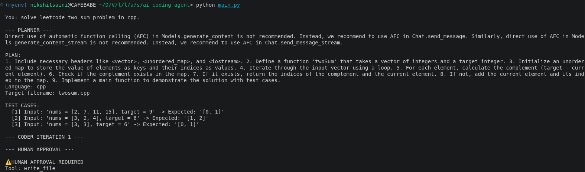
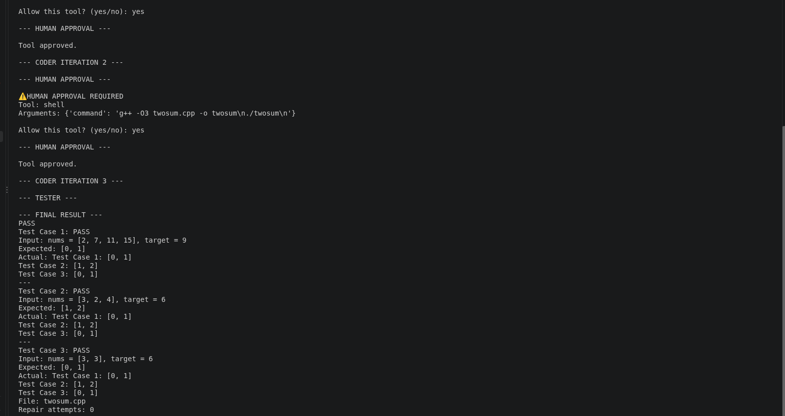
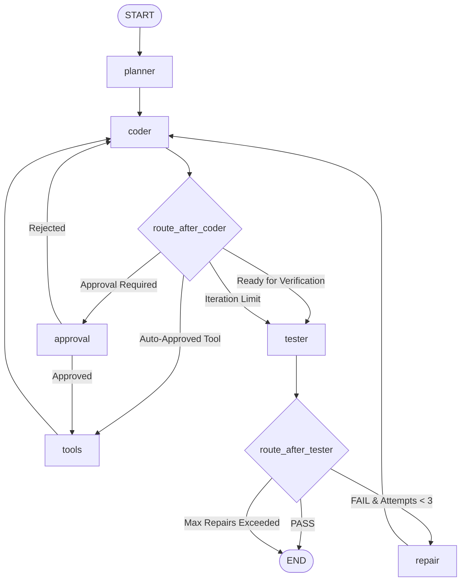

# Autonomous Polyglot Coding Agent

A deterministic, state-driven software engineering agent built on **LangGraph**, **LangChain**, and **Google Gemini** (with optional local **Ollama** support). The agent translates natural language specifications into verified source code across multiple languages, executes structured multi-case functional tests against local runtimes, enforces selective Human-in-the-Loop (HITL) authorization for mutating operations, and autonomously self-heals runtime errors and output mismatches through structured diagnostic feedback.

---

## Quick Review Example

```text
You: solve leetcode two sum problem in cpp.

--- PLANNER ---
PLAN:
1. Include necessary headers like <vector>, <unordered_map>, and <iostream>.
2. Define a function 'twoSum' that takes a vector of integers and a target integer.
3. Initialize an unordered_map to store element values and their indices.
4. Iterate through the input vector, calculating the complement (target - current).
5. If complement exists, return indices; otherwise, insert current element into map.
Language: cpp
Target filename: twosum.cpp

TEST CASES:
  [1] Input: 'nums = [2, 7, 11, 15], target = 9' -> Expected: '[0, 1]'
  [2] Input: 'nums = [3, 2, 4], target = 6'      -> Expected: '[1, 2]'
  [3] Input: 'nums = [3, 3], target = 6'         -> Expected: '[0, 1]'

--- CODER ITERATION 1 ---

--- HUMAN APPROVAL ---
⚠️ HUMAN APPROVAL REQUIRED
Tool: write_file
Arguments: {'filename': 'twosum.cpp', 'content': '#include <iostream>\n#include <vector>\n...'}

Allow this tool? (yes/no): yes
Tool approved.

--- TESTER ---
Compiling twosum.cpp via g++ -std=c++17...
Executing binary ./twosum.out...
Test Case 1: PASS | Expected: [0, 1] | Actual: [0, 1]
Test Case 2: PASS | Expected: [1, 2] | Actual: [1, 2]
Test Case 3: PASS | Expected: [0, 1] | Actual: [0, 1]

--- FINAL RESULT ---
PASS
File: twosum.cpp
Repair attempts: 0
```

### Workflow Screenshots

#### 1. Structured Planning & Human Authorization


#### 2. Tool Execution, Multi-Case Testing & Final Result


---

## System Architecture

The workflow is modeled as a compiled cyclic `StateGraph` with state checkpointing (`InMemorySaver`):



- **Loop Boundaries**: `MAX_ITERATIONS = 5` per coding pass; `MAX_REPAIRS = 3` for diagnostic repair loops.
- **State Checkpointing**: LangGraph thread memory preserves conversation and execution context across interruptions.

---

## Core Features & Technical Specification

### 1. Structured Planning & Language Routing
- The planner evaluates user intent via Pydantic structured output (`PlannerOutput`), decomposing requests into:
  - Target execution language (`python`, `cpp`, `javascript`, `bash`).
  - Target file designation (anchored extension mapping).
  - Explicit algorithmic implementation steps.
  - Formal `TestCase` specifications containing isolated `input` (stdin/args) and `expected_output` (stdout).

### 2. Multi-Language Sandboxed Execution
- Operations are strictly jailed to the project `workspace/` directory.
- The execution runner detects source extensions and handles compilation and execution:
  - **C++**: Compiles with `g++ -std=c++17 -o <binary>.out`, executes with 15s build timeout.
  - **Python**: Executes via `python3` with 10s timeout protection.
  - **JavaScript**: Executes via `node` runtime.
  - **Bash**: Executes via subshell execution.
- Subprocess timeout guards prevent hangs from unhandled interactive `stdin` loops.

### 3. Granular Human-in-the-Loop (HITL) Authorization
- Gated using LangGraph's native `interrupt()` and `Command(resume=...)` primitives:
  - **Auto-Approved Tools**: `list_files`, `read_file` (safe read-only inspection).
  - **Approval-Gated Tools**: `execute`, `delete`, `shell`, and optionally `write_file` (controlled via `ASK_APPROVAL_FOR_WRITE`).
- Rejections inject a synthetic `ToolMessage` directly into the message stack, prompting alternative implementations.

### 4. Disk-Anchored Functional Verification
- Testing evaluates actual on-disk files (`file_path.read_text()`), bypassing transient LLM message generation state.
- Structured test suites execute sequentially against target executables:
  - Automatic standard input (`stdin`) injection.
  - Standard error (`stderr`) isolation and runtime crash capture.
  - Normalization engine (`check_output_match`) supporting exact, substring, and whitespace-invariant equality.

### 5. Diagnostic Self-Repair Loop
- On verification failure, control routes to `repair_node`, querying the LLM with a structured schema (`RepairDiagnosis`):
  - **Classification**: Categorizes failure into `compilation_error`, `runtime_error`, `output_mismatch`, `missing_file`, or `timeout`.
  - **Root Cause Analysis**: Extracts technical reasons for failure from compiler diagnostics or stdout diffs.
  - **Targeted Prescription**: Provides actionable code patch instructions back to the coder node.

---

## Technical Schemas

```python
class TestCase(BaseModel):
    input: str = Field(default="", description="Input data passed via stdin or args")
    expected_output: str = Field(description="Expected stdout output")

class PlannerOutput(BaseModel):
    language: Literal["python", "cpp", "javascript", "bash", "other"]
    target_filename: str
    plan: str
    test_cases: list[TestCase]

class RepairDiagnosis(BaseModel):
    failure_type: Literal["compilation_error", "runtime_error", "output_mismatch", "missing_file", "timeout", "other"]
    root_cause: str
    suggested_fix: str

class CodingState(TypedDict, total=False):
    user_request: str
    plan: str
    code: str
    filename: str
    language: str
    expected_output: str
    test_cases: list[dict]
    test_result: str
    repair_guidance: str
    iteration: int
    repair_attempts: int
    messages: Annotated[list[BaseMessage], add_messages]
```

---

## Tool API Matrix

| Tool | Signature | Permission Policy | Description |
| :--- | :--- | :--- | :--- |
| `read_file` | `(filename: str) -> str` | Auto-approved | Reads UTF-8 content from `workspace/` |
| `list_files` | `() -> str` | Auto-approved | Lists directory contents of `workspace/` |
| `write_file` | `(filename: str, content: str) -> str` | Gated (`ASK_APPROVAL_FOR_WRITE`) | Writes/overwrites files inside `workspace/` |
| `execute` | `(filename: str, arguments: str = "", **kwargs) -> str` | Approval Required | Compiles & runs code inside `workspace/` |
| `delete` | `(filename: str) -> str` | Approval Required | Removes target file from `workspace/` |
| `shell` | `(command: str) -> str` | Approval Required | Executes shell commands in `workspace/` |

---

## Setup & Installation

### 1. System Prerequisites
- **Python**: `>= 3.11`
- **C++ Compiler** *(optional, for C++ support)*: `g++` (`build-essential`)
- **Node.js** *(optional, for JS support)*: `node`

```bash
# Ubuntu / Debian
sudo apt-get update && sudo apt-get install -y build-essential python3-venv nodejs
```

### 2. Environment Setup

```bash
# Clone repository
git clone https://github.com/NikshitSaini/AgenticCoder.git
cd ai-coding-agent

# Create and activate virtual environment
python3 -m venv .venv
source .venv/bin/activate  # Windows: .venv\Scripts\activate

# Install dependencies
pip install -r requirements.txt
```

### 3. Configuration

Create `.env` from `.env.example`:

```bash
cp .env.example .env
```

Populate the required credentials in `.env`:

```env
# Gemini API Key (Required for default model)
GOOGLE_API_KEY=your_gemini_api_key_here

# Tool Security Policy (Optional: default true)
ASK_APPROVAL_FOR_WRITE=true

# Observability (Optional)
LANGSMITH_TRACING=true
LANGSMITH_API_KEY=your_langsmith_api_key
LANGSMITH_PROJECT=ai-coding-agent
```

### 4. Running the Agent

Launch the interactive REPL:

```bash 
cd src/ai_coding_agent
python main.py
```
